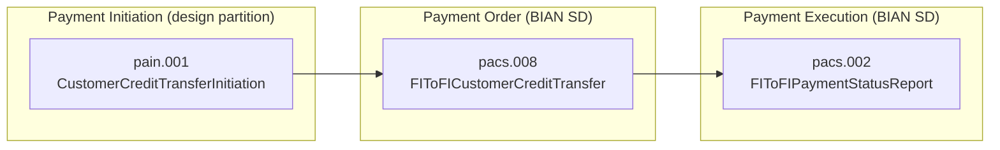
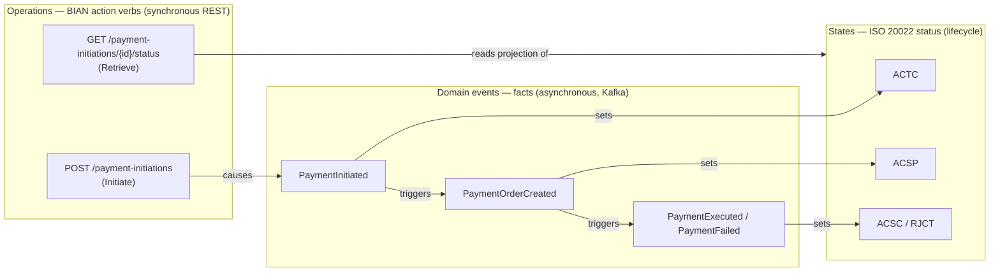

# BIAN <-> ISO 20022 Mapping

This document maps the BIAN Service Domains used in the MVP to their ISO 20022 message
representations and to the DDD building blocks in the implementation.

## Flow reference

## Service Domain mapping

> **On naming — official BIAN Service Domains vs our design partitions.**
> BIAN's official catalog defines a **Payment Order** Service Domain whose control
> record is the *Payment Order* and whose first behavior is *Initiate* (the BIAN portal
> may present this as "Payment Order/Initiation"). It covers both **initiating** and
> **managing** the payment order.
>
> In this MVP we deliberately **split that role into two bounded contexts** (a DDD
> decision) to separate the customer-facing channel from order fulfillment:
> - **Payment Initiation** — our own label for the channel/entry point. It is *not* a
>   distinct SD in the official catalog; it is a design partition.
> - **Payment Order** — maps to the official BIAN **Payment Order** Service Domain.
>
> **Payment Execution** maps to the official BIAN **Payment Execution** Service Domain.

| Our bounded context | BIAN alignment                              | Role in flow                              | ISO 20022 message | Impl                          |
| ------------------- | ------------------------------------------- | ----------------------------------------- | ----------------- | ----------------------------- |
| Payment Initiation  | Design partition (channel of Payment Order) | Capture customer payment intent (channel) | `pain.001`        | `payment-initiation` (Python) |
| Payment Order       | Official BIAN SD: **Payment Order**         | Order fulfillment, validation, Saga       | `pacs.008`        | `payment-order` (.NET)        |
| Payment Execution   | Official BIAN SD: **Payment Execution**     | Execute against rail, report status       | `pacs.002`        | `payment-execution` (.NET)    |

## BIAN Semantic API alignment

BIAN Service Domains expose behavior through a small, consistent set of action verbs
and control records. The MVP maps them to REST resources as follows:

| BIAN action verb | Meaning                              | REST expression (example)                     |
| ---------------- | ------------------------------------ | --------------------------------------------- |
| Initiate         | Create a new control record instance | `POST /payment-initiations`                   |
| Update           | Amend an in-progress instance        | `PUT /payment-orders/{id}`                    |
| Control          | Change lifecycle state               | `POST /payment-orders/{id}/control`           |
| Retrieve         | Read the current view                | `GET /payment-initiations/{id}`               |
| Execute          | Perform the fulfillment action       | `POST /payment-executions`                    |

Each Service Domain owns a **Control Record** (the primary aggregate) and one or more
**Behavior Qualifiers** (sub-features). In the MVP:

- Payment Initiation control record: `PaymentInitiation`.
- Payment Order control record: `PaymentOrder` (Event Sourced aggregate).
- Payment Execution control record: `PaymentExecution`.

## Semantic API in practice (concept -> code)

BIAN Semantic APIs mean the API shape is *derived from the business model*, not invented
per team. Three ideas drive it, and each is visible in this MVP:

| Semantic API concept        | Rule                                             | Where it lives in the MVP                                              |
| --------------------------- | ------------------------------------------------ | --------------------------------------------------------------------- |
| **Service Domain = the API**| One API boundary per Service Domain; no mixing   | Three separate contracts in `/apis` (initiation, order, execution)    |
| **Control Record = resource** | The SD's central object becomes the REST resource | `/payment-orders`, `/payment-executions`, `/payment-initiations` (tags: "BIAN control record - X") |
| **Action verbs = operations** | Operations come from BIAN's fixed verb vocabulary | `operationId` + `summary "(BIAN Initiate/Retrieve/Update/Control/Execute)"` |
| **Behavior Qualifier**      | A sub-feature of a Service Domain                | `GET .../status`, `GET .../events` ("BIAN Retrieve - behavior qualifier") |

The verbs are not arbitrary. Every operation is chosen from the BIAN vocabulary:

| BIAN verb | operationId (example)        | REST expression                       |
| --------- | ---------------------------- | ------------------------------------- |
| Initiate  | `initiatePaymentInitiation`  | `POST /payment-initiations`           |
| Retrieve  | `retrievePaymentOrder`       | `GET /payment-orders/{id}`            |
| Update    | `updatePaymentOrder`         | `PUT /payment-orders/{id}`            |
| Control   | `controlPaymentOrder`        | `POST /payment-orders/{id}/control`   |
| Execute   | `executePayment`             | `POST /payment-executions`            |

### Scope of BIAN adoption in this MVP (be precise)

This MVP adopts BIAN's **semantics** — the action verbs, the control-record-as-resource
model, and the one-API-per-Service-Domain boundary. That is the high-value part of the
standard for API design.

It does **not** adopt BIAN's canonical JSON payload shapes. Instead, message **content**
is modeled with **ISO 20022** (`pain.001`, `pacs.008`, `pacs.002`). So the split is:

- **Structure and operations** follow **BIAN** (verbs, resources, Service Domain boundaries).
- **Message content** follows **ISO 20022** (the payloads inside requests/responses).

This is a deliberate, common combination in payments. It is *not* "pure BIAN end-to-end"
in the message bodies, and that trade-off is intentional.

## Operations vs Events vs States (do not confuse these)

Three distinct concepts are easy to mix up. They live in different planes:

| Concept                     | What it is                                            | Sync/Async | Examples in this MVP                                    |
| --------------------------- | ----------------------------------------------------- | ---------- | ------------------------------------------------------- |
| **Operation** (BIAN action verb) | What a client *asks to do* over the REST API     | Synchronous| `POST /payment-initiations` (Initiate), `GET .../status` (Retrieve) |
| **Domain event**            | A *fact that already happened*, published for others  | Asynchronous | `PaymentInitiated`, `PaymentOrderCreated`, `PaymentExecuted`, `PaymentFailed` |
| **State** (ISO 20022 status)| The *current situation* of the payment in its lifecycle | n/a      | `ACTC`, `ACSP`, `ACSC`, `RJCT`                          |

Key point: **the HTTP methods are operations, not events.** An operation is a request;
an event is a consequence. Calling `POST /payment-initiations` (the *Initiate* operation)
*causes* the `PaymentInitiated` event to be published, which in turn advances the state.

Reading the diagram: a client *operation* (`POST`) produces a *domain event*
(`PaymentInitiated`); events cascade through the Saga, and each event moves the payment
to a new *state*. The `GET .../status` operation never mutates anything — it only reads
the current state from the CQRS projection.

## Field-level mapping (representative subset)

The MVP does not implement the full ISO 20022 schema. It models the fields required for
a credit-transfer happy path plus status reporting.

### pain.001 (Initiation) -> pacs.008 (Order)

| pain.001 field                                  | pacs.008 field                                | Notes                       |
| ----------------------------------------------- | --------------------------------------------- | --------------------------- |
| `GrpHdr.MsgId`                                   | `GrpHdr.MsgId` (new)                          | New id at FI-to-FI level    |
| `PmtInf.PmtInfId`                                | `CdtTrfTxInf.PmtId.InstrId`                   | Instruction id              |
| `CdtTrfTxInf.PmtId.EndToEndId`                   | `CdtTrfTxInf.PmtId.EndToEndId`                | Preserved end-to-end        |
| `CdtTrfTxInf.Amt.InstdAmt` (+`Ccy`)             | `CdtTrfTxInf.IntrBkSttlmAmt` (+`Ccy`)         | Amount + currency           |
| `PmtInf.Dbtr` / `DbtrAcct`                       | `CdtTrfTxInf.Dbtr` / `DbtrAcct`               | Debtor party + account      |
| `CdtTrfTxInf.Cdtr` / `CdtrAcct`                  | `CdtTrfTxInf.Cdtr` / `CdtrAcct`               | Creditor party + account    |
| `CdtTrfTxInf.RmtInf.Ustrd`                       | `CdtTrfTxInf.RmtInf.Ustrd`                    | Remittance information      |

### pacs.008 (Order) -> pacs.002 (Execution status)

| Source                                    | pacs.002 field                              | Notes                          |
| ----------------------------------------- | ------------------------------------------- | ------------------------------ |
| `GrpHdr.MsgId`                            | `TxInfAndSts.OrgnlGrpInf.OrgnlMsgId`        | Original message reference     |
| `CdtTrfTxInf.PmtId.EndToEndId`            | `TxInfAndSts.OrgnlEndToEndId`               | Correlates back to initiation  |
| execution outcome                         | `TxInfAndSts.TxSts`                         | `ACSC` (settled) / `RJCT`      |
| rejection reason (if any)                 | `TxInfAndSts.StsRsnInf.Rsn.Cd`              | ISO reason code                |

## Status code vocabulary (subset)

| Code   | Meaning                         | Used when                         |
| ------ | ------------------------------- | --------------------------------- |
| `ACTC` | AcceptedTechnicalValidation     | Initiation accepted               |
| `ACSP` | AcceptedSettlementInProcess     | Order created, execution pending  |
| `ACSC` | AcceptedSettlementCompleted     | Execution succeeded               |
| `RJCT` | Rejected                        | Validation or execution failed    |
