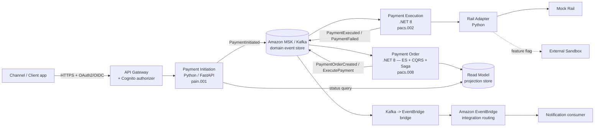

# C4 — Container View

Container-level view of the Payments MVP. (System context is implicit: external clients
call the platform; the platform talks to a payment rail — mock or external sandbox.)

## Containers

| Container          | Tech               | Responsibility                                             |
| ------------------ | ------------------ | ---------------------------------------------------------- |
| API Gateway        | Amazon API Gateway | TLS termination, throttling, Cognito JWT authorization     |
| Payment Initiation | Python / FastAPI   | Accept `pain.001`, validate, publish `PaymentInitiated`    |
| Payment Order      | .NET 8             | Event-sourced aggregate, Saga orchestration, `pacs.008`    |
| Payment Execution  | .NET 8             | Consume order, call rail adapter, emit `pacs.002`          |
| Rail Adapter       | Python             | Mock rail (default) + interface for external sandbox       |
| Event backbone     | Amazon MSK (Kafka) | Domain event store / stream                                |
| Integration bus    | Amazon EventBridge | Cross-domain routing to integrations (notifications, etc.) |
| Read model         | DynamoDB / RDS     | CQRS query side / projection                               |
