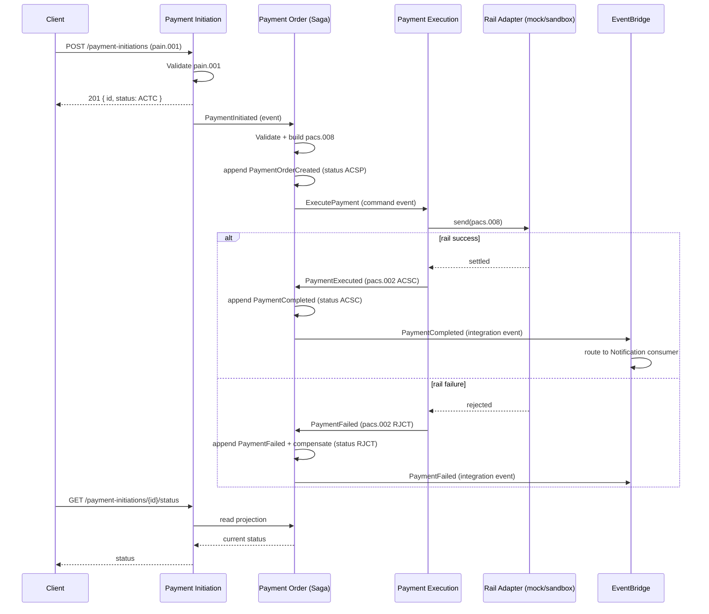

# Event-Driven Architecture — Payment Flow

The payment lifecycle is coordinated by domain events on Kafka (Amazon MSK). Integration
concerns (e.g., notifications) are routed via EventBridge, keeping domain events and
integration events separated.

## Saga sequence (happy path + failure)



## Domain events (Kafka topics)

| Event                 | Producer           | Topic                      | Consumers                     |
| --------------------- | ------------------ | -------------------------- | ----------------------------- |
| `PaymentInitiated`    | Payment Initiation | `payments.initiation.v1`   | Payment Order                 |
| `PaymentOrderCreated` | Payment Order      | `payments.order.v1`        | Payment Execution, projection |
| `PaymentExecuted`     | Payment Execution  | `payments.execution.v1`    | Payment Order (Saga)          |
| `PaymentFailed`       | Payment Execution  | `payments.execution.v1`    | Payment Order (Saga)          |
| `PaymentCompleted`    | Payment Order      | `payments.order.v1`        | projection, EventBridge bridge|

## Event envelope

All domain events share a common envelope for correlation and idempotency:

```json
{
  "eventId": "uuid",
  "eventType": "PaymentInitiated",
  "occurredAt": "2026-01-01T12:00:00Z",
  "paymentId": "uuid",
  "correlationId": "uuid",
  "schemaVersion": 1,
  "payload": { }
}
```

- `paymentId` is the aggregate id and the idempotency key across the flow.
- `correlationId` ties all events of a single business transaction together.
- `schemaVersion` supports forward-compatible evolution.

## Saga states (implemented)

The orchestrated Saga lives in Payment Order (`PaymentSaga`). Its states:

| State              | Meaning                                  |
| ------------------ | ---------------------------------------- |
| `NotStarted`       | No order exists yet                      |
| `OrderCreated`     | Order created from initiation (ACSP)     |
| `AwaitingExecution`| Submitted to execution, awaiting outcome |
| `Completed`        | Execution settled (ACSC)                 |
| `Failed`           | Execution rejected; order compensated (RJCT) |

Compensation: when execution returns a non-`ACSC` status, the Saga marks the order
failed (`Fail(reasonCode)`), moving it to `RJCT`. The status then flows back to the
Initiation read model via the CQRS status update path.

## Domain vs integration events

- **Domain events** stay on Kafka. They drive the Saga and rebuild aggregate/read state.
- **Integration events** are a curated subset forwarded to EventBridge by a bridge
  component. They are for downstream systems (notifications, analytics) and must not be
  required to advance the core Saga.
